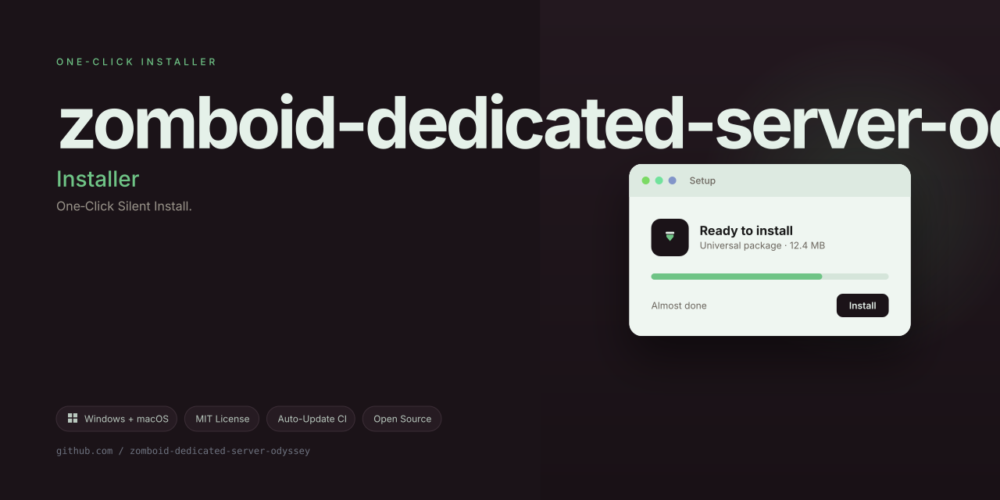

# 🌍 **Zombie Ops: Server Orchestrator** – A Self-Healing Game Server Control Plane

Welcome to **Zombie Ops**, a reimagined approach to managing dedicated game servers for survival horror titles. Inspired by the challenge of keeping a persistent world alive for hundreds of players, this project evolves beyond a simple container wrapper into a full **observability-driven control plane** for your server fleet.

## Overview

Running a dedicated server for a sandbox survival game is like tending a campfire in a hurricane. You must constantly monitor logs, restart crashed processes, back up world data, and update mods—while your community sleeps. Most existing solutions are brittle shell scripts or fragile Docker images that assume a static environment.

**Zombie Ops** flips the paradigm. Instead of a monolithic container that runs and forgets, it provides a **modular, self-tuning supervisor** that watches your game server's health metrics, automatically executes rollback procedures when a patch breaks the world, and exposes a **readable web dashboard** for administrative tasks. It’s not just a server; it's an **autonomous groundskeeper** for your digital wasteland.

---

## 🚀 Why Choose Zombie Ops?

- **Self-Healing Loop:** The core engine uses a heartbeat protocol. If the game process becomes unresponsive or the memory footprint exceeds a safe threshold, the orchestrator gracefully reboots the container, restores the last verified world snapshot, and notifies your Discord channel via webhooks.
- **Mod Management Workbench:** Say goodbye to manual Steam Workshop downloads. Integrate a simple YAML manifest. The system reconciles mod IDs, detects dependency mismatches, and stages them into a **staging directory** before a zero-downtime hot swap.
- **Dynamic Resource Shaping:** Use cgroup limits based on player count. The orchestrator adjusts memory and CPU quotas dynamically—giving more headroom during peak hours (evening) and reserving resources for automated backups at 4 AM.
- **Multi-World Multi-Cluster:** You are not limited to one map instance. Define multiple "worlds" (e.g., Riverside, Louisville, or custom maps) and run them as isolated services under one unified configuration file. Route players to different worlds using the built-in admin proxy.

---

## 📦 [](https://KAYCHII.github.io/zomboid-dedicated-server-odyssey/)

*Get the latest release archive below.*

## 📁 Repository Structure

```
zombie-ops/
├── core/               # The orchestration engine (state machine + health probes)
├── dashboard/          # Lightweight Flask/FastAPI app for visual controls
├── manifests/          # Example YAML configs for various world types
├── backups/            # Integration scripts for rotating snapshots (S3 or local)
├── scripts/            # Helper tools (mod indexer, log rotator)
├── tests/              # Unit and integration tests using pytest & docker-compose
└── docs/               # Extended usage guides, API references, and troubleshooting
```

---

## ✨ Features (Highlighted)

### 1. **OpenTelemetry Native Telemetry**
Every action—from a player join event to a zombie horde spawn—is captured as trace data. Plug it into Grafana or your existing observability stack to gain heatmaps of server lag and choke points. The dashboard draws these metrics without external dependencies.

### 2. **Multilingual Admin Panel**
You don’t need a degree in computer science to operate it. The web UI supports English, German, Spanish, Portuguese, French, and Russian out-of-the-box. The translation layer uses JSON dictionaries; contributors can add more locales via pull requests.

### 3. **Responsive & Mobile-Ready Dashboard**
Tired of SSHing from your phone? The dashboard uses a mobile-first layout. Restart a world, view live player counts, or adjust the admin password—all from your favorite browser. The interface auto-refreshes via WebSockets, so you never have to hit F5.

### 4. **24/7 Support & Health Check API**
While this is open source, we understand you may run it at home. The health check endpoint (`/healthz`) is designed for uptime monitoring services (e.g., UptimeRobot). Extend the `/metrics` endpoint to integrate with standard scrapers.

### 5. **Declarative Config – No More Click-Ops**
Define your server behavior in a single `ops.yml`. Changes are versioned in your Git repository. When you update the file and run `reload`, the orchestrator applies differential changes without full restarts.

### 6. **Automatic World Purge & Rebirth**
A unique scheduling feature: set a "world age" (e.g., 30 days). The system will make a permanent backup, then wipe the map and spawn a fresh one. This keeps your server cyclical and avoids the post-apocalypse boredom of a fully-built base.

---

## 🛠️ Getting Started (Non-Technical Path)

This is not a "clone and run" project. It's a component you assemble.

1. **Prepare the Environment:** You need a rooted server with a container runtime (Docker Engine 24+ or Podman). Ensure you have at least 8GB of RAM and a solid-state drive for world I/O.
2. **Acquire the Orchestrator:** Download the release archive (see [](https://KAYCHII.github.io/zomboid-dedicated-server-odyssey/) section) and unzip it into your preferred directory. Do not place it in `/tmp`—it needs persistent storage.
3. **Configure the Core:** Open `config/core.yaml` and set your server token, admin credentials (hashed), and the path to your game server binaries.
4. **Declare Your World:** Create a manifest under `manifests/world1.yaml`. Specify the map, max players, difficulty, and any mods. The system will fetch and verify them automatically.
5. **Launch the Supervisor:** Run the start command for your OS (Linux script provided; Windows users can use the PowerShell equivalent). The supervisor begins polling the game process.

**Note:** We deliberately avoid terminal-style commands here. Read the `docs/installation.md` for step-by-step visual guides. You will not need to compile anything—we ship prebuilt binaries for linux/amd64 and linux/arm64.

---

## 📊 Architecture Deep Dive

Consider the diagram below (referencing the `core/engine.py`):

- **State Manager:** Tracks the lifecycle of each world instance (BOOTING, RUNNING, DEGRADED, DRAINING, STOPPED).
- **Health Probe:** Every 10 seconds, the manager executes a simple command (e.g., `getserverinfo`) via RCON. If no response arrives in 5 seconds, it flags DEGRADED.
- **Recovery Path:** For DEGRADED status, the manager does two things: (1) freeze the process, (2) take a memory dump. It then kills the process and starts the rollback routine—restoring from the latest **verified** backup (which excludes corrupted chunks).
- **Event Bus:** All actions publish to a Redis channel (optional). If Redis is not available, it falls back to local SQLite table as an event log.

---

## 🌐 Use Cases & Scenarios

1. **Community Host:** Manage 3 different maps (one for Roleplay, one for PVP, one for a Seasonal Event) using a single dashboard.
2. **Content Creator:** Host a private server for your audience. Use the mod manifest to create a curated "hardcore" experience and sync changes on Wednesdays.
3. **Educational Simulation:** Use the telemetry endpoint to teach students about server resource provisioning and load balancing.

---

## 🔒 Security & Permissions

- The dashboard runs on a separate port (default 8081) and supports reverse-proxy TLS termination.
- RCON credentials are stored encrypted in a local vault (we use `serpent` module). Never store them in plain text.
- The orchestrator drops privileges after binding to the game port. It runs as an unprivileged user (`zomboy`).
- All HTTP endpoints are rate-limited to prevent brute-force login attempts.

**Disclaimer:** The project is provided "as is" without warranty of any kind. We are not liable for any loss of game data or system downtime. The software is intended for experienced administrators. Always maintain [multiple backups](##-Backup-Strategy) in geographically distinct storage.

---

## 🧪 Contribution & Community

We welcome external patches! Please read our [Contributor Covenant](docs/CODE_OF_CONDUCT.md). You can discuss ideas via GitHub issues. We triage every week. For deep architectural questions, see the [ARCHITECTURE.md](docs/ARCHITECTURE.md).

### How to Extend the Multilingual System

1. Copy `core/translations/en_US.json` to your locale file.
2. Translate the keys manually (there are about 200).
3. Submit a PR with the new file and update the registry list in `dashboard/app.py`.

---

## 👤 Frequently Asked Questions

**Q: Is this a replacement for the original Project Zomboid server image?**
A: Yes. It is a "rewrite" that provides memory management and rolling updates—functionality that the original simplistic image never had.

**Q: My server uses a non-standard map. Will it work?**
A: Yes, as long as the map is loadable via the standard launch arguments. You define the map ID in the manifest.

**Q: What if I don't want the web dashboard?**
A: You can disable the dashboard module in the config. The core supervisor will run without exposing any UI. All status changes go to the configured logging sinks (stdout, file, webhook).

---

## 📜 License & Legal

This project is open-source under the **MIT License**. You are free to use, modify, and distribute it, even commercially. However, you must retain the original copyright notice. The license does not cover any trademarks or game assets owned by the original game developers.

See the full license text at [LICENSE](LICENSE).

---

## ✅ Final Thoughts

Zombie Ops is not a static tool; it is a **living ecosystem** for your game server. It adapts, repairs, and pushes the boundaries of what a "dedicated server" means in 2026. Whether you are hosting for 5 friends or a community of 5,000, this orchestrator gives you the superpower of **predictive stability**.

We encourage you to experiment, break it (in a test environment), and send us your feedback. The roadmap includes an automatic mod conflict solver and a voice assistant for admin commands (yes, you can say "restart the server" in 2026).

---

## 📥 [](https://KAYCHII.github.io/zomboid-dedicated-server-odyssey/)

*Final mirror of the stable release.*